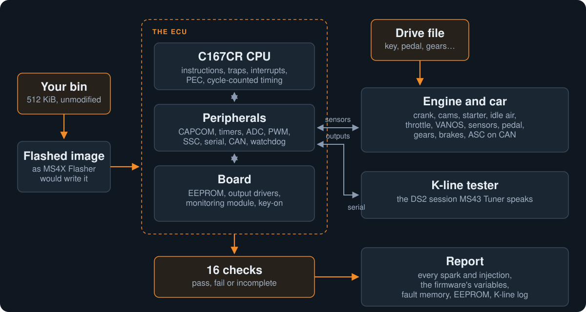

<div align="center">

# MS43 Emulator

**Run a Siemens MS43 bin from power-on on your PC, drive it, and see what the ECU does, before you flash it.**

A cycle-counted emulator of the MS43's Infineon C167CR and its board, with an engine and a car around it.<br>
It runs the real firmware, unmodified: stock MS430069-family software, MS43X001, or your own patched bin.

[](LICENSE)
[](https://dotnet.microsoft.com/)

[What it does](#what-it-does) · [Quick start](#quick-start) · [Drives and checks](#drives-and-checks) · [Compare two bins](#compare-two-bins) · [Build and test](#build-and-test) · [Reference](docs/reference.md)

</div>

> [!IMPORTANT]
> A pass from the emulator means the firmware did what its own logic says, on the inputs a drive feeds it. It is
> **not** an engine-safety clearance: there is no combustion, knock or octane model, no measured fuelling and no
> thermal model. Every report says so (`physical calibration safety: NotEvaluated`). Judge a calibration on the
> car, with the right instruments.

## What it does

<p align="center">
  
</p>

- **Boots the real firmware.** The boot block, the checksum tasks, the monitoring-module handshake and the
  scheduler run as on the ECU. A key-off runs the after-run, writes the EEPROM and drops the main relay; the
  next key-on reads it back.
- **Runs an engine and a car around it.** A warm engine idles on the firmware's own target. Every spark, dwell
  and injection is the firmware's decision, logged with the crank angle and the values behind it.
- **Plays drives.** A short text file says what the driver does: key on, crank, idle, pull in 4th, lift, clutch
  in, A/C on, a fault. Drives run across power cycles, from a blank or a seasoned EEPROM.
- **Checks the run.** 16 checks look at crashes, resets, the scheduler, the outputs and the engine, and every
  fault code is explained or flagged. The verdict is pass, fail or incomplete.
- **Talks on the K-line.** A tester on ASC0 plays the DS2 session of
  [MS43 Tuner](https://github.com/raph559/MS43_TUNER), so logging and live tuning are tested against the real
  firmware.
- **Compares two bins.** Both bins go through the same drives, and the report lists their calibration, code and
  behaviour differences, down to the cylinder and the crank degree.

It was built to develop [MS43 Tuner](https://github.com/raph559/MS43_TUNER) and the live-tuning overlay
([MS43X001_CUSTOM](https://github.com/raph559/MS43X001_CUSTOM)): every overlay version ran here, on scripted
drives, before it went near a car.

## What you need

| For | You need |
|:---|:---|
| **Building** | The [.NET 10 SDK](https://dotnet.microsoft.com/). Developed on Windows; it has no Windows-only code that we know of, but other systems are untested |
| **Running** | An MS43 bin (512 KiB). No bin and no firmware is included: bring your own |
| **Compare names** | Optionally, the MS43X001 XDF from the [MS4X project](https://github.com/ms4x-net/MS43X-Custom-Firmware), to name constants |

It has been developed and checked mostly on MS43X001 (M54B25) and the car file it runs on. The checks that read
the firmware's RAM know MS43X001's layout; on stock software those checks report *incomplete* rather than guess.

## Quick start

```bash
git clone https://github.com/raph559/MS43_EMULATOR.git
cd MS43_EMULATOR
dotnet build -c Release Ms43Sim.sln
```

Then, with your bin at `my.bin`:

```bash
# Boot it: does it reach the scheduler?
dotnet src/Ms43Sim.Cli/bin/Release/net10.0/ms43sim.dll boot my.bin

# Start the engine and idle for a minute
dotnet src/Ms43Sim.Cli/bin/Release/net10.0/ms43sim.dll run my.bin --engine warm-idle

# Run the seven standard drives, six at a time
dotnet src/Ms43Sim.Cli/bin/Release/net10.0/ms43sim.dll check my.bin --jobs 6
```

Each command writes a folder under `runs/`: a Markdown report, `events.csv` (every output change), `trace.csv`
(the firmware's variables every 100 ms), the EEPROM at the end and an `assessment.json`. The exit code is the
verdict: **0 pass, 1 fail, 4 incomplete**.

## Drives and checks

A drive is plain text, one step per line: how many seconds, then what happens.

```text
# The overrun fuel cut: a lift at 110 km/h in 4th, then the clutch in.
drive overrun
start seasoned
set coolant=90 oil=90 intake=33 ambient=20
3 on
1.5 crank rpm=200
6 idle
6 drive gear=4 speed=25..110 pedal=30
10 drive gear=4 speed=110..30 pedal=0    # the lift: the overrun fuel cut
2 drive gear=4 speed=30 pedal=0 clutch=1
5 idle
```

[`drives/`](drives) holds the seven standard drives (warm start, cold start, idle, part load, full load, overrun,
key cycle) and the overlay's own sets: the live-tuning session and its abuse, pops, the downshift blip and the map
watch. The drive file format, the options and the checks are in the [reference](docs/reference.md#drive-it-run---drive-and-check).

## Compare two bins

```bash
dotnet src/Ms43Sim.Cli/bin/Release/net10.0/ms43sim.dll compare stock.bin tuned.bin --jobs 6
```

`compare` runs both bins through the same drives and reports:

- **calibration:** every table, axis and constant with changed bytes;
- **code:** the changed byte ranges, with a listing;
- **behaviour:** where the two runs part, per cylinder for sparks and injections and per sample for the trace,
  with the operating point there (rpm, air mass, coolant, speed, the drive's line).

Tolerances are printed in every report. Read a code change on a drive in gear with care: any change in the
program's timing shifts the phase of the controllers, and the report says so.

## Build and test

```bash
dotnet build -c Release Ms43Sim.sln
dotnet test Ms43Sim.sln --filter "Category!=StandardDrives"
```

There are about a thousand xUnit tests: the instruction set against the manuals, every peripheral, board device
and engine plant, the K-line, drives, checks, the compare and the live-tuning overlay. The tests that boot or drive
real bins read them from a `bins/` folder you point to with `MS43_BINS_ROOT`, and check each one's SHA-256; those
bins are not published, so without them only the bin-free tests can run. The `StandardDrives` category (the long
drives) takes about ten minutes more.

On a desktop PC the emulator runs at around 110 to 130 million C167 cycles a second, about 5 times faster than
the real ECU; `check` of seven drives takes about half a minute with `--jobs 6`.

## Layout

| Path | Content |
|:---|:---|
| [`src/Ms43Sim.Core/`](src/Ms43Sim.Core) | The image tools, CPU, memory map, peripherals, board, engine and car, K-line, drives, checks, runners and the compare |
| [`src/Ms43Sim.Cli/`](src/Ms43Sim.Cli) | The `ms43sim` command: `boot`, `run`, `check`, `compare`, `decode` |
| [`tests/Ms43Sim.Tests/`](tests/Ms43Sim.Tests) | xUnit tests, and the overlay builds as Intel HEX fixtures |
| [`drives/`](drives) | The standard drives and the overlay's drives |
| [`tools/`](tools) | Python helpers for the C167 manuals and the decoder |
| [`HARDWARE.md`](HARDWARE.md) | Every device the emulator models, its evidence in the firmware and the manuals, and what is stubbed |
| [`docs/reference.md`](docs/reference.md) | The full manual: every command and option, the drive format, the compare's tolerances, and the assumptions of each development stage |

## Contributing

Bug reports and pull requests are welcome; see [CONTRIBUTING.md](CONTRIBUTING.md). Never attach a bin to an issue
or a pull request: describe it (firmware, SHA-256) instead.

## License

GPL-3.0-only ([LICENSE](LICENSE)). The emulator contains no ECU firmware. The C166 instruction set manual and
the C167CR user's manual it was written from are Infineon's and are not included. MS43X001 is by the
[MS4X project](https://github.com/ms4x-net/MS43X-Custom-Firmware); Siemens MS43 software belongs to its owners.
